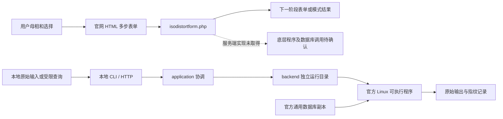

# ISODISTORT 本地化调查入口

调查对象是本项目 `evidence/environment/source_manifest.json` 冻结的官方发行包，
以及 2026-10-20 实际访问的 ISODISTORT 网站。全部新代码与持久化研究产物位于
桌面 `CRIS_REA`；原 `E:\CRIS` 只作来源读取。
`evidence/environment/source_preservation.json` 已复核 25 个原始发行包文件及本地副本
的哈希、原工作树 Git 状态和原回归计数文件均未变化。该核查不冒充旧工作树所有文件
的逐字节快照。

## 可以直接使用的成果

本项目已从空目录建立一个独立的 Python 本地程序，提供命令行和浏览器入口。
它调用许可范围内的五个官方 Linux 程序，为每次调用建立工作目录和数据库副本，
保留输入、原始输出、进程状态和文件指纹。安装、运行和能力边界的唯一入口是
[README](../README.md)，执行语义见 [LOCAL_CONTRACT](LOCAL_CONTRACT.md)。

这是一套可执行的研究基础设施。当前受限表单可以提交母相空间群、IR、OPD、
可选 Wyckoff 字母，取得官方 ISO 的子群与投影输出。它还没有实现
“任意母相 CIF + k/IR/OPD → 完整归一化畸变模式与导出”的科学工作流。
特别不能把单个 Wyckoff 投影、程序退出码零或与官网一个例子一致，称为完整 Method 2。

## 调查发现与证据入口

1. **下载包的计算角色。** `iso` 处理表示、序参量方向、各向同性子群与投影；
   `findsym` 识别结构对称性；`findsym_cifinput` 转换 CIF；
   `smodes` 构造位移对称模式；`comsubs` 进行有范围约束的公共子群搜索。
   依据是随附手册、ELF 符号、真实进程输出和局部函数分析，而不是程序名的猜测。
   详见 [NATIVE_ANALYSIS](NATIVE_ANALYSIS.md)。
2. **“二进制数据库”需要拆开理解。** 可执行程序是 ELF；数据库文件主要为有标签的
   文本段，包含空间群、Wyckoff、不可约表示、小群、各向同性子群、磁群和超空间群等
   通用资料。整数编码不能未经解码直接当矩阵元。已定位的字段、数量、字节偏移、
   NUL 异常及尚未确认的维度/布局，见 [DATABASE_FORMATS](DATABASE_FORMATS.md)。
3. **官网交互是有状态的多步表单。** 已捕获公开 SrTiO3 示例的
   母相 → GM → GM4− → P1 → 完整模式详情，实际 POST 到
   `isodistortform.php`，使用隐藏字段传递阶段状态。CIF 上传使用独立入口。
   浏览器请求不能证明 PHP 内部调用哪个可执行文件、哪条命令或哪个版本；
   本次没有服务端源码或服务器进程追踪。字段、响应哈希、REA Evidence 与限制见
   [WEB_PROTOCOL](WEB_PROTOCOL.md)。
4. **本地链已实际执行。** 真实浏览器通过本地 HTTP 和 Windows/WSL 调用 ISO，
   原始输入 `221 / GM4- / P1 / a` 得到 `99 P4mm`、指数 `6` 和方向 `(1,0,0)`。
   独立的有限立方群检查解释本例的指数和不变方向；它不推导全部空间群标签，
   也不构成一般 k/IR 的正确性证明。工程测试、浏览器实测、失败反例与适用域见
   [LOCAL_VALIDATION](LOCAL_VALIDATION.md) 和 [REVIEW_NOTES](REVIEW_NOTES.md)。

两条已知链路可以概括为：

官网公开完整结构例子与本地单 Wyckoff 查询不是相同的计算合同。本项目没有把它们
冒充完整数值对照，也没有从官网结果提取模式、归一化、子群答案或映射用于本地求解。
官网捕获保存在 `evidence/web/`，生产程序不读取该目录。

## 如何复核一条结论

先读对应报告的适用条件，再查看其原始证据；程序和数据库身份由 SHA-256 固定。
`evidence/native/runtime/` 中输入先于本地运行固定，输出保持原文。
`evidence/validation/` 区分使用测试替身的工程检查、真实官方进程和真实浏览器场景。
逆向恢复的伪代码和符号是分析产物，不等于开发团队的原始源代码。
REA 环境及重放方法见 [NATIVE_RUNTIME](NATIVE_RUNTIME.md)。

各报告明确区分官方文档陈述、机器码观察、本项目推导、受限实验和未解决项。
没有完成的数据解码、网站服务端执行链和科学合同不会用推断填成“已验证”。

## 后续实现顺序

按课题组选择，优先实现母相结构、k/IR/OPD 到模式的链路。
具体可检验的开发任务与完成条件集中在 [DEVELOPMENT_PLAN](DEVELOPMENT_PLAN.md)，
不把这些待办写成已有能力。完整站点复现、磁性和超空间扩展均未在本次声明通过。
